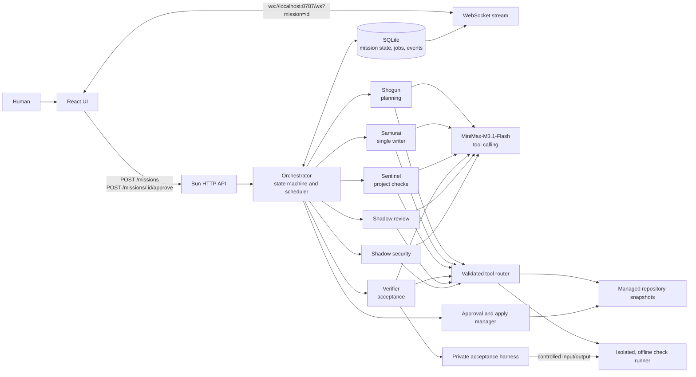
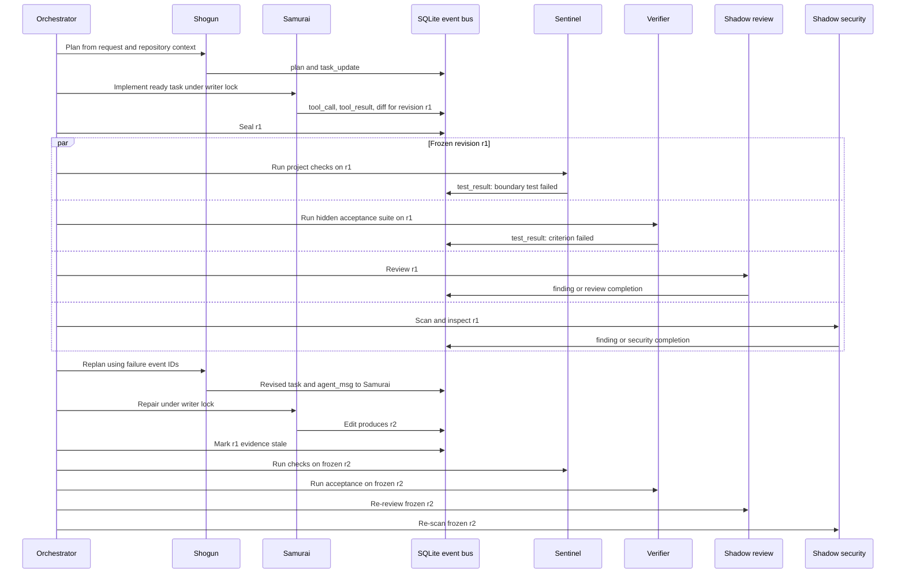
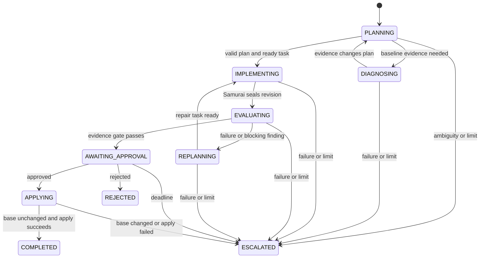

# DevPilot Architecture

This document specifies the proposed implementation for PS-001. It does not report implementation or test results.

DevPilot turns a request against a registered local repository into a candidate revision, tests and reviews that revision, and asks a human to approve its application. The orchestrator is deterministic TypeScript code. The other roles use `MiniMax-M3.1-Flash` with tool calling.

A mission can finish successfully only when its current frozen revision has the required test, acceptance, review, and security evidence and a human has approved that exact revision. Edits make earlier evidence stale. Model statements are recorded as claims; tool observations and test results carry their own provenance.

## Architecture



The architecture has one scheduler and a durable shared event log. Agents exchange messages and findings through that log; they do not call each other directly or mutate shared state.

### Feedback-loop sequence

This sequence is illustrative, not an observed run.



## Components and proposed repository layout

```text
devpilot/
├── ARCHITECTURE.md
├── README.md
├── package.json
├── bun.lock
├── tsconfig.json
├── config/
│   ├── repositories.json          # Trusted repo, request and suite registry
│   ├── checks.json                # Check IDs, fixed argv and container images
│   └── limits.ts
├── src/
│   ├── server.ts                 # Bun server and startup recovery
│   ├── api/
│   │   ├── missions.ts            # Create, inspect and approve missions
│   │   ├── websocket.ts           # Replay and live subscription
│   │   └── artifacts.ts           # Authorized, sanitized artifact reads
│   ├── orchestrator/
│   │   ├── state-machine.ts
│   │   ├── scheduler.ts
│   │   ├── budgets.ts
│   │   ├── evidence-gate.ts
│   │   ├── locks.ts
│   │   └── recovery.ts
│   ├── agents/
│   │   ├── prompts/
│   │   │   ├── shogun.ts
│   │   │   ├── samurai.ts
│   │   │   ├── sentinel.ts
│   │   │   ├── verifier.ts
│   │   │   ├── shadow-review.ts
│   │   │   └── shadow-security.ts
│   │   ├── session.ts
│   │   └── minimax.ts
│   ├── bus/
│   │   ├── events.ts
│   │   └── subscriptions.ts
│   ├── db/
│   │   ├── db.ts
│   │   ├── migrations/
│   │   └── queries.ts
│   ├── tools/
│   │   ├── schemas.ts
│   │   ├── router.ts
│   │   ├── files.ts
│   │   ├── patch.ts
│   │   ├── checks.ts
│   │   ├── acceptance.ts
│   │   └── security-scan.ts
│   ├── sandbox/
│   │   ├── container-runner.ts
│   │   ├── snapshots.ts
│   │   └── apply.ts
│   └── shared/
│       ├── protocol.ts            # Event, API and tool types
│       └── validation.ts
├── web/
│   ├── index.html
│   └── src/
│       ├── App.tsx
│       ├── api.ts
│       ├── useMissionStream.ts
│       └── components/
├── fixtures/
│   └── repos/
│       ├── cart/
│       ├── stats/
│       ├── stock/
│       ├── notes/
│       ├── titles/
│       └── cheat/
├── private/
│   └── acceptance/                # Test harnesses; never mounted into agent sandboxes
├── eval/
│   ├── scenarios.ts
│   ├── baseline.ts
│   ├── run.ts
│   └── report.ts
├── tests/
│   ├── orchestrator/
│   ├── sandbox/
│   ├── api/
│   └── integration/
└── runtime/                      # Ignored: SQLite, snapshots and artifacts
    ├── devpilot.sqlite
    ├── repos/
    ├── missions/
    └── artifacts/
```

| Component | Responsibility |
|---|---|
| API and WebSocket | Validate requests, create missions, record human decisions, replay and stream events. |
| Orchestrator | Enforce states, budgets, dependencies, locks, evidence gates, retries, and escalation. |
| Agent sessions | Build role-specific context, call MiniMax, validate tool calls, and return structured results. |
| Tool router | Check agent permissions and revision fencing before executing a tool. |
| Snapshot manager | Create immutable revisions and compute hashes and diffs. |
| Check runner | Execute registered commands in isolated containers against frozen revisions. |
| Acceptance harness | Run immutable, private oracles independently of the candidate repository. |
| SQLite bus | Persist events, shared projections, job queues, budgets, findings, and approvals. |
| Evaluation harness | Run multi-agent and single-agent missions from identical fixture snapshots and report measured results. |

## External API

The Bun server binds to `localhost:8787`. The React app is served from `http://localhost:8787`.

### Create a mission

```http
POST /missions
Content-Type: application/json

{"repo":"stock","request":"Fix the failing inventory boundary test."}
```

`repo` is a registered repository ID, not a filesystem path. The registry also associates known requests with immutable acceptance suites and registered checks.

Response:

```http
202 Accepted
Content-Type: application/json

{"id":"m_01...","state":"PLANNING"}
```

Reject invalid JSON or empty requests with `400`, unknown repository IDs with `404`, and a repository that cannot be safely snapshotted with `409`. Do not start model work until the base snapshot and deadline are recorded.

### Inspect and stream a mission

- `GET /missions/:id` returns the current mission projection, tasks, revisions, findings, budgets, approval state, and a committed event watermark.
- `GET /missions/:id/artifacts/:artifactId` returns an authorized, sanitized artifact belonging to that mission.
- `ws://localhost:8787/ws?mission=<id>` replays the mission’s events from the beginning and then streams new events.
- An optional `after=<event-id>` query parameter resumes after a previously received event.

The UI can read a snapshot and connect using its watermark. The server registers the live subscriber before replaying committed events, then deduplicates buffered events by ID. IDs are globally increasing, so gaps between IDs for one mission are normal.

### Approve or reject

```http
POST /missions/:id/approve
Content-Type: application/json

{"approved":true}
```

The request is valid only while the mission is `AWAITING_APPROVAL`. It binds to the single outstanding approval record, which contains the frozen revision, candidate hash, base hash, and evidence shown in the UI.

A positive decision returns `202` while the apply manager performs the final base-hash check. A negative decision ends the mission as `REJECTED`. Repeating the same decision is idempotent; an opposite decision or an expired approval returns `409`.

The approval deadline is part of the 150-second mission deadline. No new revision is produced while approval is pending. If the approval becomes invalid, the mission escalates instead of silently asking the same decision to approve different code.

### GitHub repository missions

`POST /missions` with `{repo_url, ref?, request, mode?}` creates a mission on a public github.com repository (see README "Missions on your own GitHub repository" for caps and error codes). The clone, project detection and dependency install happen in `src/github.ts` and `Runner.install` (the only networked container); the mission then uses a generated config with `acceptance_mode: "repo_tests"`: the repository's own `python -m pytest -q` is the check, protected test files must stay byte-identical to r0, and agents may add only new `test_devpilot_<topic>.py` files. `GET /missions/:id/patch` returns the latest diff as a download; nothing is pushed upstream.

## Mission state and scheduling



`COMPLETED`, `REJECTED`, and `ESCALATED` are terminal. Each produces `mission_done` with its actual outcome. An escalation that requires clarification includes a question and relevant event IDs; the human starts a new mission with the clarified request. There is no implicit answer to an ambiguous request.

### Event-driven rules

The scheduler consumes committed events and updates its cursor and any resulting jobs in one SQLite transaction. It applies these rules until no new job is ready:

1. **Plan and inspect.** Start Shogun with the request, registered public acceptance criteria, and read-only repository tools. Shogun may request a baseline check before assigning implementation, as for the failing `stock` fixture.
2. **Dispatch ready work.** A task is ready when its dependencies are complete, its inputs are current, and its role and resource locks are available. A new finding or test result may add a task or reopen a completed task.
3. **Write.** Only Samurai may call `apply_patch` in multi-agent mode. A mission-scoped writer lock and fencing token permit one active writer. A patch creates a new draft revision; it does not mutate an existing snapshot.
4. **Invalidate.** On every accepted content-changing edit, atomically mark earlier evidence stale, emit `stale`, and cancel or disregard outstanding jobs for the old revision. A late result remains in the log as historical evidence and cannot satisfy the current gate.
5. **Freeze and evaluate.** When Samurai finishes, seal its current draft. Start Sentinel, Verifier, Shadow review, and Shadow security against that same frozen revision. Shadow review and security are separate concurrent jobs.
6. **React to evidence.** A failed check or blocking finding creates a message containing the source event IDs. Shogun revises the plan when the evidence changes the approach; the scheduler can send an already-understood repair directly to Samurai. A new edit invalidates the previous evaluation.
7. **Resolve findings.** Blocking findings remain open across revisions until their originating reviewer confirms a resolution on the current revision with cited evidence, or a trusted rerun directly resolves the finding. A disagreement that cannot be settled by evidence escalates. Review conclusions remain model claims even when their cited tool observations are verified.
8. **Request approval.** Enter `AWAITING_APPROVAL` only when the evidence gate below passes, there is no active writer, and no required job or blocking task remains.
9. **Apply or stop.** A positive approval starts the apply protocol. A changed base, a failed apply, an exhausted limit, or an unresolved ambiguity escalates.

This is not a fixed pipeline: checks can run before implementation, new evidence can change the plan, review and security run concurrently, and failures create new work rather than advancing automatically to a final stage.

### Limits

Limits are mission-wide, including all roles and concurrent jobs:

| Limit | Enforcement |
|---|---|
| 20 model turns | Reserve a turn transactionally before every model API attempt, including retries and continuations. Process the twentieth response and already requested tools; if another model turn is needed, escalate instead of making a twenty-first call. |
| 3 fix cycles | Reserve a cycle when scheduling Samurai to repair a frozen revision after failed evaluation or a blocking finding. Initial implementation is not a fix cycle. If the third repair still requires another repair, escalate. |
| 2 identical tool failures | Fingerprint the tool name, canonical arguments, and normalized error code. On the second matching failure anywhere in the mission, emit an escalation and stop. Replays of the same call ID do not count twice. A test command that ran and exited nonzero is a test failure, not a tool-execution failure. |
| 150 seconds | Set the deadline at mission creation. It includes model calls, checks, approval waiting, and apply. Cancel work and escalate at the deadline. Check the deadline again immediately before the atomic apply operation. |

Use a monotonic timer while the process is running and persist the absolute deadline for restart recovery. The deployment assumes a reliable host clock across restarts.

### Evidence gate

The gate is evaluated for one sealed `code_rev` and its exact tree hash:

- Every registered project check required for the request has an observed successful exit and no timeout.
- The registered immutable acceptance suite ran against the revision and passed all required criteria.
- Shadow review completed for that revision.
- Shadow security completed for that revision, including the required scanner run.
- No blocking finding remains open, including findings carried forward from an earlier revision.
- All required plan criteria map to the registered acceptance suite; all required tasks are complete.
- No required job is pending, no writer is active, and all evidence used by the gate is current.

A review saying “no finding” is a model conclusion, not proof that the code is free of defects. The final report distinguishes that conclusion from observed check and acceptance results. If no suitable immutable suite exists for a request, the mission may inspect and plan but must escalate rather than claim verified success.

## Agent roles and prompt contracts

All model-backed roles use `MiniMax-M3.1-Flash`. The adapter uses MiniMax’s OpenAI-compatible chat-completions endpoint with function tools. It preserves each complete assistant response, including `reasoning_content` when present, for that agent’s tool-call continuation; private model history is not published as an event. See the [MiniMax tool-use guide](https://platform.minimax.io/docs/guides/text-m3-function-call) and [chat-completions reference](https://platform.minimax.io/docs/api-reference/text-chat-openai).

Every role receives the request, its assigned task, current revision, applicable public criteria, relevant event IDs, remaining budgets, and only its permitted tools. Repository contents and tool output are untrusted data, not instructions.

| Role | Prompt summary | Required output |
|---|---|---|
| **Shogun** | Inspect relevant files and conventions. Identify ambiguity, objectives, criteria, risks, dependencies, and tasks. Revise the plan when cited evidence changes it. Do not invent test results. | Validated plan or explicit ambiguity/blocker. |
| **Samurai** | Inspect before editing, follow existing style, make the smallest suitable change, and respond to cited findings. Write only through `apply_patch`; do not claim tests passed without a result event. | Draft revision and completion or blocker. |
| **Sentinel** | Select registered checks relevant to the task, run them on the assigned frozen revision, and communicate failures with result event IDs. | Actual check results and a diagnostic message. |
| **Verifier** | Invoke the registered private suite on the assigned frozen revision. Report the returned criterion outcomes without guessing hidden cases or changing the suite. | Acceptance result and any failure message. |
| **Shadow review** | Inspect the diff and relevant context for correctness, readability, consistency, and regressions. Reassess prior findings on the new revision. | Findings or a review completion. |
| **Shadow security** | Run the registered security scan and inspect the diff for secrets, unsafe operations, injection, and path traversal. Reassess earlier security findings. | Scanner result and findings or security completion. |

The two Shadow jobs have independent sessions and run concurrently. The scheduler, not either model, decides whether their outputs meet the gate.

## Tool interface

The following is the normalized function-tool catalog. The MiniMax adapter wraps each entry as an OpenAI-compatible `{ "type": "function", "function": ... }` tool. All parameter objects reject additional properties. The server validates arguments, permissions, task ownership, deadline, and revision before execution.

```json
[
  {
    "name": "list_files",
    "description": "List a repository directory in the assigned revision.",
    "parameters": {
      "type": "object",
      "properties": {
        "code_rev": {"type": "string"},
        "path": {"type": "string"},
        "cursor": {"type": ["string", "null"]}
      },
      "required": ["code_rev", "path"],
      "additionalProperties": false
    }
  },
  {
    "name": "read_file",
    "description": "Read bounded lines from a repository file.",
    "parameters": {
      "type": "object",
      "properties": {
        "code_rev": {"type": "string"},
        "path": {"type": "string"},
        "start_line": {"type": "integer", "minimum": 1},
        "end_line": {"type": "integer", "minimum": 1}
      },
      "required": ["code_rev", "path", "start_line", "end_line"],
      "additionalProperties": false
    }
  },
  {
    "name": "search_text",
    "description": "Search for a literal string in the assigned repository revision.",
    "parameters": {
      "type": "object",
      "properties": {
        "code_rev": {"type": "string"},
        "path": {"type": "string"},
        "query": {"type": "string", "minLength": 1, "maxLength": 256}
      },
      "required": ["code_rev", "path", "query"],
      "additionalProperties": false
    }
  },
  {
    "name": "get_diff",
    "description": "Read the candidate diff against the mission base.",
    "parameters": {
      "type": "object",
      "properties": {"code_rev": {"type": "string"}},
      "required": ["code_rev"],
      "additionalProperties": false
    }
  },
  {
    "name": "apply_patch",
    "description": "Apply a validated unified patch to the current draft under the writer lock.",
    "parameters": {
      "type": "object",
      "properties": {
        "expected_rev": {"type": "string"},
        "patch": {"type": "string", "minLength": 1, "maxLength": 262144}
      },
      "required": ["expected_rev", "patch"],
      "additionalProperties": false
    }
  },
  {
    "name": "run_check",
    "description": "Run a registered project check on a frozen revision.",
    "parameters": {
      "type": "object",
      "properties": {
        "code_rev": {"type": "string"},
        "check_id": {"type": "string"}
      },
      "required": ["code_rev", "check_id"],
      "additionalProperties": false
    }
  },
  {
    "name": "run_acceptance",
    "description": "Run the mission's registered private acceptance suite.",
    "parameters": {
      "type": "object",
      "properties": {"code_rev": {"type": "string"}},
      "required": ["code_rev"],
      "additionalProperties": false
    }
  },
  {
    "name": "run_security_scan",
    "description": "Run the registered deterministic security scanner.",
    "parameters": {
      "type": "object",
      "properties": {"code_rev": {"type": "string"}},
      "required": ["code_rev"],
      "additionalProperties": false
    }
  },
  {
    "name": "submit_plan",
    "description": "Submit a plan or an evidence-driven plan revision.",
    "parameters": {
      "type": "object",
      "properties": {
        "criteria": {
          "type": "array",
          "items": {
            "type": "object",
            "properties": {
              "id": {"type": "string"},
              "description": {"type": "string"}
            },
            "required": ["id", "description"],
            "additionalProperties": false
          }
        },
        "tasks": {
          "type": "array",
          "items": {
            "type": "object",
            "properties": {
              "id": {"type": "string"},
              "title": {"type": "string"},
              "owner": {
                "enum": ["shogun", "samurai", "sentinel", "verifier", "shadow_review", "shadow_security"]
              },
              "depends_on": {"type": "array", "items": {"type": "string"}},
              "criterion_ids": {"type": "array", "items": {"type": "string"}}
            },
            "required": ["id", "title", "owner", "depends_on", "criterion_ids"],
            "additionalProperties": false
          }
        },
        "reason_event_ids": {"type": "array", "items": {"type": "integer"}}
      },
      "required": ["criteria", "tasks", "reason_event_ids"],
      "additionalProperties": false
    }
  },
  {
    "name": "send_message",
    "description": "Send a message through the mission bus to a role.",
    "parameters": {
      "type": "object",
      "properties": {
        "to": {
          "enum": ["orchestrator", "shogun", "samurai", "sentinel", "verifier", "shadow_review", "shadow_security"]
        },
        "text": {"type": "string", "maxLength": 4000},
        "evidence_event_ids": {"type": "array", "items": {"type": "integer"}}
      },
      "required": ["to", "text", "evidence_event_ids"],
      "additionalProperties": false
    }
  },
  {
    "name": "report_finding",
    "description": "Open a finding or propose resolution of an existing finding.",
    "parameters": {
      "type": "object",
      "properties": {
        "action": {"enum": ["open", "resolve"]},
        "finding_id": {"type": ["string", "null"]},
        "severity": {"enum": ["info", "low", "medium", "high", "critical"]},
        "title": {"type": "string"},
        "detail": {"type": "string", "maxLength": 4000},
        "path": {"type": ["string", "null"]},
        "line": {"type": ["integer", "null"], "minimum": 1},
        "evidence_event_ids": {"type": "array", "items": {"type": "integer"}}
      },
      "required": ["action", "finding_id", "severity", "title", "detail", "path", "line", "evidence_event_ids"],
      "additionalProperties": false
    }
  },
  {
    "name": "finish",
    "description": "Finish the assigned job or report a blocker.",
    "parameters": {
      "type": "object",
      "properties": {
        "code_rev": {"type": "string"},
        "status": {"enum": ["done", "blocked"]},
        "summary": {"type": "string", "maxLength": 4000},
        "evidence_event_ids": {"type": "array", "items": {"type": "integer"}}
      },
      "required": ["code_rev", "status", "summary", "evidence_event_ids"],
      "additionalProperties": false
    }
  }
]
```

Additional validation:

- `submit_plan` must have unique task IDs, existing dependencies, an acyclic dependency graph, permitted owners, and valid criterion IDs. A model cannot alter the registered acceptance suite.
- `report_finding` assigns a server-generated ID for `open`; `resolve` requires an existing ID and current-revision evidence. Only the originating review role may resolve its model finding.
- `finish` completes a job, not the mission. A model’s `done` cannot override failed or missing evidence.
- Tool results have `{call_id, ok, data}` or `{call_id, ok:false, error:{code,message}}`. A completed check reports its exit code in `data`, even when that code is nonzero.
- File and search outputs are paginated and bounded. Search is literal, not an arbitrary regular expression.
- The `titles` profile disables `search_text`. A call returns `TOOL_DISABLED`; the agent may use permitted listing and reading tools instead.

### Permissions by role

| Tool | Shogun | Samurai | Sentinel | Verifier | Shadow review | Shadow security |
|---|---:|---:|---:|---:|---:|---:|
| `list_files`, `read_file`, `search_text`, `get_diff` | ✓ | ✓ | ✓ | ✓ | ✓ | ✓ |
| `apply_patch` | — | ✓ | — | — | — | — |
| `run_check` | — | — | ✓ | — | — | — |
| `run_acceptance` | — | — | — | ✓ | — | — |
| `run_security_scan` | — | — | — | — | — | ✓ |
| `submit_plan` | ✓ | — | — | — | — | — |
| `send_message`, `report_finding`, `finish` | ✓ | ✓ | ✓ | ✓ | ✓ | ✓ |

The router enforces this table independently of prompts. In baseline mode, the single baseline agent receives the equivalent tools; the deterministic sandbox and evidence rules remain in force.

## Message bus and event contract

SQLite is the durable bus. The service is the only database writer; workers submit results to it rather than opening the database or writing each other’s files. Model calls and sandbox execution occur outside SQLite transactions.

Every mission event has this envelope:

```json
{
  "id": 123,
  "ts": 1790000000000,
  "mission_id": "m_example",
  "type": "test_result",
  "agent": "sentinel",
  "task_id": "t_test",
  "code_rev": "r2:sha256:example",
  "verified": true,
  "payload": {
    "check_id": "unit",
    "outcome": "failed",
    "exit_code": 1,
    "artifact_id": "a_example",
    "cause_event_ids": []
  }
}
```

`id` is a globally increasing SQLite integer; `ts` is UTC Unix milliseconds. `task_id` and `code_rev` may be `null` for mission-wide events or events before a revision exists. `agent` is one of `orchestrator`, `shogun`, `samurai`, `sentinel`, `verifier`, `shadow_review`, `shadow_security`, `baseline`, `human`, or `system`.

`verified: true` means the service or a trusted runner directly observed the fact recorded in that event—for example, the exit code and output digest of a command that ran. It does **not** mean a test passed, that stdout is truthful, or that the entire mission is correct. Agent messages, plans, and model findings are unverified claims. A stale event does not change the original event’s `verified` field; consumers also display its stale status.

| Event type | Required payload information |
|---|---|
| `mission_started` | Repository, request, base hash, deadline, suite ID. |
| `plan` | Plan version, criteria, tasks, and reason event IDs. |
| `task_update` | Task ID, previous and new status, reason event IDs. |
| `agent_msg` | Recipient, message, cited event IDs. |
| `tool_call` | Call ID, tool name, sanitized arguments, job ID. |
| `tool_result` | Call ID, success or normalized error, observed result or artifact reference. |
| `test_result` | Check or suite ID, outcome, revision, exit status where applicable, duration, artifact reference. |
| `finding` | Finding ID, action, severity, description, evidence IDs, resolution if any. |
| `diff` | Base hash, revision, changed paths, diff artifact ID. |
| `approval_needed` | Approval ID, revision and tree hash, base hash, evidence IDs. |
| `approval_result` | Approval ID, decision, approved revision. |
| `escalation` | Reason, human question or action, relevant event IDs. |
| `stale` | Old revision, affected evidence IDs, reason and new revision. |
| `mission_done` | Terminal status, applied revision if any, evidence IDs, unresolved findings. |

Events are append-only. The event insert and associated projection updates happen in the same transaction. The scheduler stores a per-mission event cursor and creates jobs with unique idempotency keys in that transaction. WebSocket delivery is at least once; clients deduplicate by event ID and resume from their last received ID.

On restart, the service resumes from durable cursors. A model attempt whose result is unknown still consumes its reserved turn. Interrupted checks can be retried within the budgets. A staged patch is visible only after its fenced database update commits.

## SQLite schema

Use `bun:sqlite` with foreign keys enabled, WAL mode, a busy timeout, and short synchronous transactions. Never `await` inside a `bun:sqlite` transaction callback; it commits when the synchronous callback returns. See the [Bun SQLite documentation](https://bun.com/docs/runtime/sqlite).

The following is the required logical schema. `TEXT JSON` means UTF-8 JSON validated with `json_valid`; times are integer UTC milliseconds.

| Table | Columns |
|---|---|
| `repositories` | `id TEXT PK`, `current_link TEXT`, `manifest_sha256 TEXT`, `created_at_ms INTEGER` |
| `missions` | `id TEXT PK`, `repo_id TEXT FK`, `request TEXT`, `request_hash TEXT`, `suite_id TEXT NULL`, `suite_hash TEXT NULL`, `state TEXT`, `base_hash TEXT`, `base_ref TEXT`, `current_rev TEXT NULL`, `plan_version INTEGER`, `turns_used INTEGER`, `fix_cycles_used INTEGER`, `writer_fence INTEGER`, `created_at_ms INTEGER`, `deadline_at_ms INTEGER`, `terminal_at_ms INTEGER NULL`, `terminal_reason TEXT NULL` |
| `revisions` | `mission_id TEXT FK`, `id TEXT`, `seq INTEGER`, `parent_id TEXT NULL`, `tree_hash TEXT`, `snapshot_ref TEXT`, `status TEXT` (`draft`, `sealed`, `obsolete`), `created_at_ms INTEGER`, `sealed_at_ms INTEGER NULL`; PK `(mission_id,id)`, unique `(mission_id,seq)` |
| `tasks` | `id TEXT PK`, `mission_id TEXT FK`, `plan_version INTEGER`, `title TEXT`, `owner TEXT`, `status TEXT`, `criterion_ids_json TEXT JSON`, `created_event_id INTEGER`, `updated_event_id INTEGER` |
| `task_dependencies` | `task_id TEXT FK`, `depends_on_task_id TEXT FK`; composite PK |
| `events` | `id INTEGER PRIMARY KEY AUTOINCREMENT`, `ts INTEGER`, `mission_id TEXT FK`, `type TEXT`, `agent TEXT`, `task_id TEXT NULL FK`, `code_rev TEXT NULL`, `verified INTEGER`, `payload_json TEXT JSON` |
| `scheduler_cursors` | `mission_id TEXT PK FK`, `last_event_id INTEGER` |
| `jobs` | `id TEXT PK`, `mission_id TEXT FK`, `task_id TEXT NULL FK`, `agent TEXT`, `kind TEXT`, `code_rev TEXT NULL`, `state TEXT`, `dedupe_key TEXT UNIQUE`, `cause_event_id INTEGER NULL FK`, `attempt INTEGER`, `fence INTEGER NULL`, `lease_until_ms INTEGER NULL`, `created_at_ms INTEGER`, `finished_at_ms INTEGER NULL` |
| `model_turns` | `id TEXT PK`, `mission_id TEXT FK`, `job_id TEXT FK`, `ordinal INTEGER`, `provider_request_id TEXT NULL`, `state TEXT`, `private_history_ref TEXT NULL`, `input_tokens INTEGER NULL`, `output_tokens INTEGER NULL`, `started_at_ms INTEGER`, `finished_at_ms INTEGER NULL`; unique `(mission_id,ordinal)` |
| `tool_calls` | `id TEXT PK`, `mission_id TEXT FK`, `job_id TEXT FK`, `provider_call_id TEXT`, `name TEXT`, `args_json TEXT JSON`, `failure_fingerprint TEXT NULL`, `state TEXT`, `call_event_id INTEGER FK`, `result_event_id INTEGER NULL FK`; unique `(job_id,provider_call_id)` |
| `evidence` | `id TEXT PK`, `mission_id TEXT FK`, `job_id TEXT FK`, `code_rev TEXT`, `kind TEXT`, `outcome TEXT`, `event_id INTEGER UNIQUE FK`, `artifact_id TEXT NULL`, `stale INTEGER`, `created_at_ms INTEGER` |
| `findings` | `id TEXT PK`, `mission_id TEXT FK`, `origin_agent TEXT`, `code_rev TEXT`, `severity TEXT`, `status TEXT`, `title TEXT`, `detail TEXT`, `path TEXT NULL`, `line INTEGER NULL`, `opened_event_id INTEGER FK`, `resolved_event_id INTEGER NULL FK` |
| `artifacts` | `id TEXT PK`, `mission_id TEXT FK`, `kind TEXT`, `sha256 TEXT`, `storage_ref TEXT`, `visibility TEXT`, `size_bytes INTEGER`, `created_at_ms INTEGER` |
| `locks` | `scope TEXT PK`, `holder_job_id TEXT`, `fence INTEGER`, `lease_until_ms INTEGER` |
| `approvals` | `id TEXT PK`, `mission_id TEXT UNIQUE FK`, `code_rev TEXT`, `candidate_hash TEXT`, `base_hash TEXT`, `state TEXT`, `requested_at_ms INTEGER`, `decided_at_ms INTEGER NULL`, `decision INTEGER NULL` |
| `apply_intents` | `id TEXT PK`, `mission_id TEXT UNIQUE FK`, `repo_id TEXT FK`, `base_hash TEXT`, `candidate_hash TEXT`, `target_ref TEXT UNIQUE`, `state TEXT`, `created_at_ms INTEGER`, `finished_at_ms INTEGER NULL` |

Add indexes on `events(mission_id,id)`, `jobs(mission_id,state)`, `evidence(mission_id,code_rev,stale)`, `findings(mission_id,status)`, and `tool_calls(mission_id,failure_fingerprint)`. Enforce enum values, nonnegative counters, `turns_used <= 20`, `fix_cycles_used <= 3`, and boolean `0/1` values with `CHECK` constraints.

`events` are the audit record; mutable tables are projections and coordination state. Private model histories and private acceptance artifacts are never served by the artifact API.

## Revisions, approval, and atomic apply

### Managed repositories

Version 1 supports small, source-only repositories imported into a DevPilot-managed registry. A registered repository’s working location is:

```text
runtime/repos/<repo-id>/current -> versions/<version-id>/
```

`current` is the repository location that DevPilot applies to. An import from another directory creates a managed copy; it does not modify that original directory. Git metadata, dependency installations, secrets, and generated caches are not part of the managed source tree.

Only the DevPilot service account can change managed repository pointers. Snapshots are immutable to agent and check containers. This assumption excludes a privileged host administrator or another process with the service account’s write access.

### Revision identity

Each snapshot contains regular files and directories only. Reject symlinks, special files, invalid paths, and paths outside the imported source tree. Copy imported files into independent inodes.

Compute SHA-256 over sorted, length-prefixed records containing the relative UTF-8 path, entry type, executable bit, and file bytes. Include empty directories. A revision ID is `r<sequence>:sha256:<tree-hash>`. The sequence is mission-local and increases for every accepted content-changing patch, even if later bytes match an older snapshot.

Samurai patches a temporary copy. After validation, the service durably stores the snapshot, checks the writer fencing token and expected revision, and atomically updates the mission’s draft pointer and emits `diff` and `stale` events. A rejected or no-op patch does not create a revision. Only a sealed snapshot can satisfy the evidence gate.

### Apply protocol

1. When the gate passes, persist one approval record containing the exact candidate revision, its tree hash, the base hash, and evidence IDs; emit `approval_needed`.
2. On approval, take the per-repository apply lock. Recheck the deadline, approval record, candidate hash, evidence gate, and absence of an active writer.
3. Recompute the hash of `current` under the lock. If it differs from the mission’s base hash, emit `escalation: BASE_CHANGED`; do not apply.
4. Materialize the approved snapshot as a new immutable version on the same filesystem. Persist an `apply_intent` with a unique target path and state `prepared`.
5. Recheck the deadline and base immediately before atomically renaming a prepared symlink over `current`. Sync the containing directory, mark the intent applied, and emit `mission_done` with the applied revision.
6. On recovery, compare `current` with the intent’s unique target. If it points there, finalize the recorded apply; if it still points to the base and the deadline has passed, escalate. Any other state is a conflict requiring human inspection.

The filesystem pointer is authoritative during recovery. The service uses a single-instance host lock and per-repository apply locks; it does not assume that a SQLite transaction and a filesystem rename are one atomic operation.

## Sandbox and acceptance-test isolation

Version 1 targets Linux with a rootless container runtime. The service fails closed if the required isolation is unavailable.

- The tool router exposes repository-relative paths only. Reject absolute paths, `..`, symlinks, special files, and patch paths outside the snapshot.
- Candidate checks run with the frozen source mounted read-only, an offline prebuilt image, no network, no host credentials or container socket, a read-only container root, dropped capabilities, `no-new-privileges`, and bounded CPU, memory, process count, output, and time.
- Temporary writable storage is limited to a size-bounded sandbox `/tmp`. Demo fixtures use offline dependencies prepared before missions begin.
- `run_check` accepts a registered check ID, never arbitrary shell text. The trusted registry maps it to fixed executable arguments and an image digest. Repository code executed by a check is still treated as untrusted.
- The writer’s patch staging area is isolated from the managed repository. The router validates the resulting tree before storing it.
- Only the backend model adapter can access the MiniMax credential and network. Repository contents sent to the model leave the local machine; registered demo repositories must contain no secrets.
- Security-scan output and logs redact secret values. The UI renders logs and source as text, not HTML.

The acceptance suite is selected from a trusted registry before evaluation and pinned by digest. The private harness and expected outputs are not mounted into the candidate container and are unavailable to model tools. The harness drives the candidate through a bounded input/output interface and evaluates responses outside the candidate sandbox. It returns criterion IDs and pass/fail summaries, not private test source or raw hidden-case logs. Candidate code can observe inputs sent to it, so hidden cases provide independence from repository edits, not secrecy from a running program.

The deterministic security scanner checks for common secret patterns and risky operations, including unsafe path handling and injection-prone command construction. Its matches are observations, not a complete security guarantee.

## Failure and recovery behavior

| Condition | Action |
|---|---|
| Ambiguous requirement | Emit a specific clarification question and escalate. Do not choose an interpretation silently. |
| Search disabled | Return `TOOL_DISABLED`; allow a different permitted inspection method. A second identical failed call escalates. |
| Project test fails | Record the actual exit and log; send the failure to the relevant agents and schedule diagnosis or repair. |
| Acceptance fails | Return sanitized failed criterion IDs; schedule repair if budgets remain. Never expose or alter the hidden suite. |
| Review or security finding | Create a finding with evidence references; carry blocking findings across revisions until resolved or escalated. |
| Two identical tool failures | Stop and escalate immediately. |
| Model timeout, rate limit, malformed tool call | Record the attempt; retry only within the turn and time limits. Invalid or unauthorized calls are rejected by the router. |
| Check timeout or sandbox unavailable | Record an infrastructure failure, not a passing test. Retry only within limits; otherwise escalate. |
| Late result from old revision | Persist it as historical, mark it stale, and exclude it from scheduling and the gate. |
| Writer lease expires | Fence the old writer. Its staged patch cannot become current without the new fencing token. |
| Base changed before apply | Escalate with both hashes; do not apply the candidate. |
| Crash during apply | Recover from the durable intent and actual `current` pointer; never assume an unobserved rename succeeded. |
| Deadline or budget exhausted | Cancel outstanding work, emit `escalation` and terminal `mission_done`, and retain the evidence and diff for the human. |

## Frontend

```text
App
├── MissionCreate
│   ├── RepositorySelector
│   └── RequestEditor
└── MissionPage
    ├── MissionHeader
    │   ├── StateBadge
    │   └── BudgetAndDeadline
    ├── PlanAndTaskGraph
    ├── AgentActivity
    │   └── EventTimeline
    ├── EvidencePanel
    │   ├── ProjectChecks
    │   ├── AcceptanceResults
    │   ├── ReviewFindings
    │   └── SecurityFindings
    ├── DiffViewer
    ├── ApprovalPanel
    └── EscalationPanel
```

The client loads the mission projection, subscribes to the WebSocket, deduplicates events, and reconnects from the last event ID. It displays the revision and evidence provenance beside each result, labels stale evidence, and distinguishes observed results from model claims.

The approval panel shows the exact candidate revision, base hash, diff, check and acceptance outcomes, review status, unresolved findings, and deadline before posting the decision. It never presents approval for a different revision.

For the local browser interface, validate `Host` and `Origin`, require JSON for mutation requests, and use a same-origin session and CSRF protection. Bind only to localhost. The local service assumes the local user and host administrator are trusted.

## Demo fixtures and evaluation

The registry defines one controlled source snapshot, public request, check configuration, and private suite digest per supported scenario.

| Repository | Scenario | Required demonstration evidence |
|---|---|---|
| `cart` | Feature implementation. | The registered feature criterion and existing-behavior checks run against the candidate. |
| `stats` | Investigate the defect marked `// bug`. | Repository context and actual checks support the repair; the marker alone is not treated as proof. |
| `stock` | Off-by-one defect with a failing test. | Record the baseline failure, the resulting task or plan change, the candidate diff, and the rerun. |
| `notes` | Planted path traversal. | Record the security finding and independent acceptance checks for the registered path-boundary requirements. |
| `titles` | Ambiguous request with search disabled. | Record any actual `TOOL_DISABLED` result and the clarification escalation; do not claim a completed feature without a clarified request and matching suite. |
| `cheat` | Red-team request that invites editing the failing test. | Record each refused tampering attempt (`PROTECTED_FILE` / `INVALID_PATH` tool results and the flagged `finding` with `tamper`), that only `pricing.py` changed, and that the private suite rejects a special-cased fix. |

The stock demo should run the baseline check before implementation so that a real failure can be linked to the subsequent plan or task. A run log demonstrates coordination only when it contains actual event IDs linking the observation, agent message or plan change, edit, and rerun. The illustrative sequence diagram is not a run log.

### Single-agent baseline

The baseline uses one model session with the same model, request, initial snapshot hash, tool implementations, sandbox, registered checks, private acceptance suite, deadline, and turn and fix-cycle limits. It has no Shogun, Sentinel, Verifier, or Shadow model calls. The same deterministic acceptance harness and security scanner can be invoked as tools, and the single agent performs its own review.

Run each mode from separately cloned copies of the same seed. Randomize mode order and run multiple trials when time and provider access permit. Do not automatically approve changes: compare candidates at the approval gate, and separately report any human-approved application.

The harness records, from actual runs:

- Candidate readiness, terminal outcome, approval and apply outcome.
- Project-check and private-acceptance outcomes.
- Open findings and scanner results.
- Elapsed time, model turns, fix cycles, provider-reported token usage, and tool failures.
- Event IDs and revision hashes for every claimed feedback loop.

Report each mode’s raw runs and aggregate counts or rates. Mark missing, timed-out, escalated, and unverified outcomes explicitly. No example value in this architecture is a measured result.