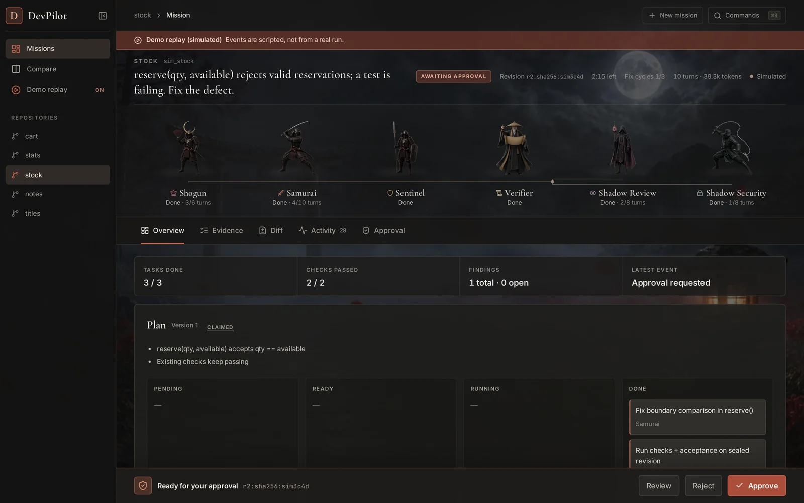
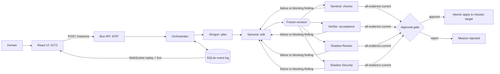
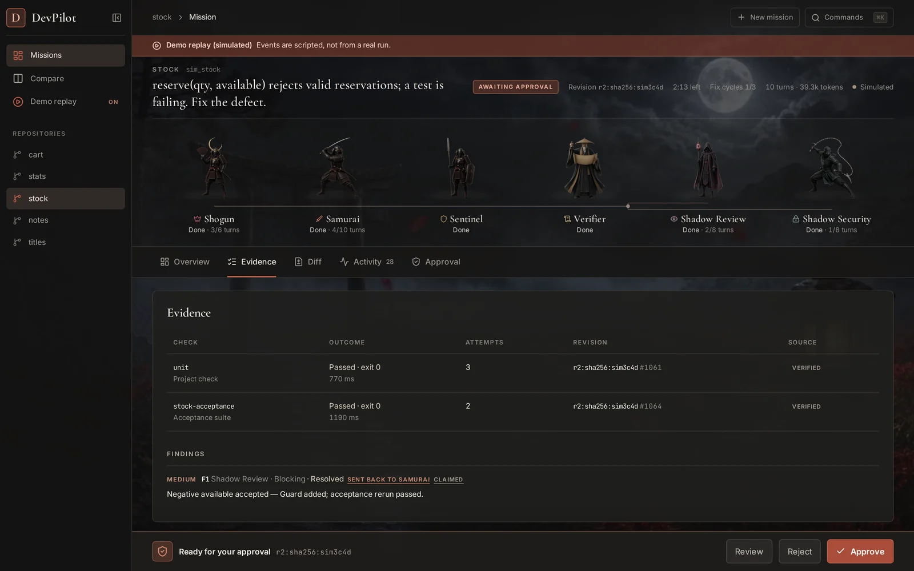
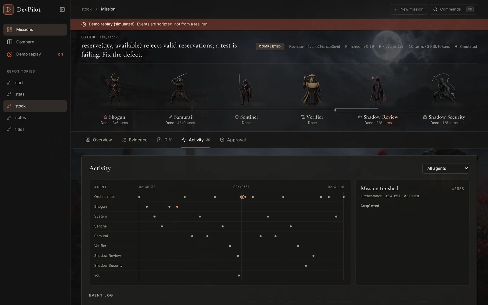
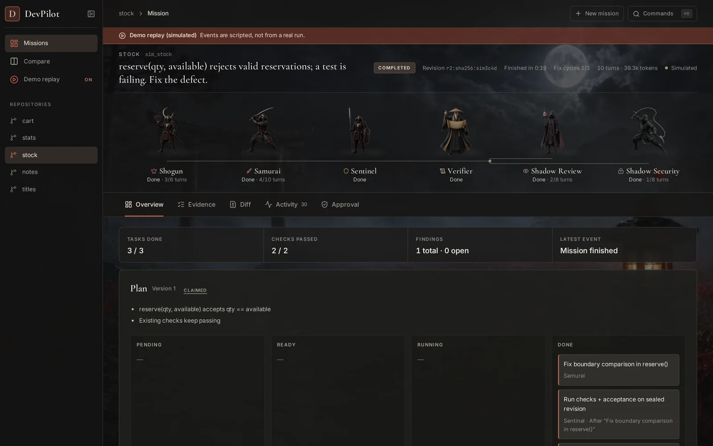

# DevPilot

A multi-agent engineering system that plans, edits, tests and reviews a change to a local repository, then waits for a human to approve the exact revision it checked. Built for PECathon 2026, problem statement PS-001.



Demo video (60 s): [docs/media/devpilot-demo.mp4](docs/media/devpilot-demo.mp4)

## The agents

A deterministic TypeScript orchestrator schedules six roles. The model roles use MiniMax-M3.1-Flash with tool calling; Samurai is the only role that can edit files.

| | Agent | Role | What it does |
|---|---|---|---|
|  | Shogun | Planner | Reads the request and the baseline check, writes acceptance criteria and tasks |
|  | Samurai | Coder | The single writer. Edits through staged, path-confined copies and may run only the registered check |
|  | Sentinel | Tester | Runs the project's own checks against the frozen candidate revision |
|  | Verifier | Acceptance | Runs the private acceptance suite, isolated from candidate code |
|  | Shadow Review | Code review | Reviews the full diff; in-scope findings backed by file and line or a failing case send work back |
|  | Shadow Security | Security review | Reviews the diff together with a pattern scanner; scanner hits are advisory |

## Architecture



- Every fact is an event in SQLite. The UI replays and streams them over WebSocket.
- Any edit makes earlier evidence stale. Approval is offered only when the current revision has passing checks, passing acceptance and no blocking findings.
- At most three fix cycles. After that, or on a deadline, turn limit or missing isolation, the mission escalates instead of asking for approval.
- On approval the service re-checks the candidate and base hashes, then swaps `runtime/missions/<id>/target/current` atomically. The seed repo and other missions are untouched.

See [ARCHITECTURE.md](ARCHITECTURE.md) for the full design.

## Isolation

Project checks and acceptance tests run in rootless Podman (or Docker) containers with networking disabled, bounded resources and a read-only candidate mount. The service refuses to start without a rootless runtime and an image pinned by digest (`DEVPILOT_CONTAINER_IMAGE=name@sha256:...`).

The image only needs Python 3 and pytest. The one used during development was `python:3.12-slim` plus `pip install pytest`:

```sh
printf 'FROM python:3.12-slim\nRUN pip install --no-cache-dir pytest\n' | podman build -t devpilot-py:1 -
podman image inspect devpilot-py:1 --format '{{.Digest}}'
```

For acceptance, pytest and the candidate run in separate offline containers. Candidate code is reached only through a restricted RPC proxy and never sees the private suite. Every `test_result` event carries `isolation: "isolated"` or `"unisolated"`.

For trusted local development only, `DEVPILOT_ALLOW_UNISOLATED=1` explicitly permits host subprocess execution without Docker or Podman. **This provides no security boundary against repository code**: it can access host files, processes, and network under the service account. Each resulting `test_result` includes `payload.isolation: "unisolated"`. Such missions escalate with `ISOLATION_UNAVAILABLE` and cannot enter the approval gate. The server passes a restricted environment to subprocesses, but the flag is unsuitable for untrusted code.

## Quick start

Requirements: Bun, Python 3 with pytest, and rootless Podman or Docker.

```sh
bun install
cd web && bun install && cd ..
```

Environment variables (names only; set the values in your shell, never commit them):

| Variable | Purpose |
|---|---|
| `MINIMAX_API_KEY` or `MINIMAX_TOKEN_PLAN_KEY` | MiniMax credentials for MiniMax-M3.1-Flash |
| `DEVPILOT_MODEL` | Set to `mock` for deterministic scripted runs |
| `DEVPILOT_CONTAINER_IMAGE` | Pinned image, `name@sha256:<digest>` |
| `DEVPILOT_RUNTIME` | Runtime directory (SQLite DB, mission copies) |
| `DEVPILOT_FIXTURES_DIR` | Fixture directory, default `../devpilot-fixtures` |
| `DEVPILOT_REGISTRY` | Override `config/repositories.json` |
| `DEVPILOT_REASONING_EFFORT` | `low` (default) to `max` |
| `DEVPILOT_ALLOWED_ORIGINS` | Extra browser origins; default allows :5173 |

```sh
bun run start            # API and WebSocket on 127.0.0.1:8787
cd web && bun run dev    # UI on http://localhost:5173
```

The UI also has a demo replay (`?replay=1`), labelled "Demo replay (simulated)", which plays a scripted mission without the backend.

## Demo repositories

The fixture registry contains five seed repositories. Each one has an exact registered request, a check command and a private acceptance suite pinned by digest:

| Repo | Request |
|---|---|
| `stock` | `reserve(qty, available)` rejects valid reservations; fix the defect |
| `stats` | Investigate the defect marked `# bug` in `stats.py` and fix it if confirmed |
| `cart` | Add percentage and fixed-amount discount codes to the cart |
| `notes` | Fix path handling so notes cannot escape the store root (absolute paths, symlinks) |
| `titles` | "clean up the titles", a deliberately vague request |

Live runs from the command line: `scripts/live-stock-mission.ts`, `scripts/live-notes-mission.ts`, `scripts/live-parallel-missions.ts`, plus `scripts/live-plan-check.ts`, which makes a single planning call.

## Tests

```sh
bun test                 # 74 tests across 5 files
cd web && bun test && bunx tsc --noEmit -p . && bun run build
```

The integration tests use the fixture directory and explicitly enable the unisolated development runner.

## Live results

Multi-agent missions on MiniMax-M3.1-Flash. All four reached the approval gate and finished COMPLETED after human approval.

| Repo | Model turns | Send-backs | Active time |
|---|---:|---:|---:|
| notes | 39 | 1 | 242 s |
| stock | 15 | 0 | 97 s |
| cart | 20 | 0 | 125 s |
| stats | 18 | 0 | 111 s |

| Evidence | Activity | Completed |
|---|---|---|
|  |  |  |

## Event contract

Each WebSocket message is `{id, ts, mission_id, type, agent, task_id, code_rev, verified, payload}`. `id` is a global, increasing SQLite ID; resume with `/ws?mission=<id>&after=<event-id>` and deduplicate by `id`. `verified` means the service observed the fact itself. Plans, messages and review conclusions are recorded as claims.

Event types: `mission_started`, `plan`, `task_update`, `agent_msg`, `tool_call`, `tool_result`, `test_result`, `finding`, `diff`, `approval_needed`, `approval_result`, `escalation`, `stale`, `usage`, `mission_done`.

Full payloads, usage accounting and pairing: [docs/EVENTS.md](docs/EVENTS.md).

## Project structure

```
src/             Bun backend: server, orchestrator (service.ts), model adapter, tools, runner, verifier, SQLite store
src/verification acceptance harness and RPC bridge
tests/           backend, fixture, structured-output and verification tests
config/          repository registry pointer
scripts/         live mission scripts
web/             React + Vite UI (mission view, agent pipeline, approval gate, demo replay)
docs/            EVENTS.md and media
ARCHITECTURE.md  design document
```

## Team

- [@nexurlabs](https://github.com/nexurlabs) / [@rishabhiskawai](https://github.com/rishabhiskawai)
- [@Divyam-77](https://github.com/Divyam-77)
- [@sbm-bit](https://github.com/sbm-bit)

## Backend reference

### API and execution

- `POST /missions` accepts `{"repo":"stock","request":"<exact registered request>","mode":"multi"}`. Use `"baseline"` for the single-agent baseline. The response includes `mission_id`.
- `GET /missions/:id` returns mission state, usage totals, pairing fields, and an event watermark.
- `GET /missions/:id/artifacts/:artifactId` returns a mission-scoped diff or redacted debug artifact as plain text.
- `ws://localhost:8787/ws?mission=<id>&after=<event-id>` replays and streams events.
- For a paired baseline, pass `"mode":"baseline"` and `"paired_mission_id":"<multi-agent-mission-id>"` with the same repo and request. The baseline starts from the multi-agent run's original base.
- `POST /missions/:id/approve` accepts `{"approved":true}` or false only at the approval gate. Apply changes `runtime/missions/<mission-id>/target/current`; the fixture seed and other missions are not modified. The candidate and base hashes are checked again before the atomic pointer swap. A repeated decision returns `409`.

Model turns have separate mission-wide and per-role caps. The initial mission cap is 44 turns (52 for feature requests), with 16 added per fix cycle up to 100 turns. `DEVPILOT_MISSION_TURN_LIMIT` sets the initial cap (1–200), `DEVPILOT_TURN_EXTENSION_PER_FIX` sets the increment (default 16, 0 disables it), and `DEVPILOT_MAX_MISSION_TURNS` sets the hard maximum (default 100, or the initial cap if higher; at least the initial cap and at most 200). Shogun has 6 turns; Samurai starts at 16 (22 for features), adding 8 per fix cycle up to 48 and the effective mission cap. Set `DEVPILOT_SAMURAI_TURN_EXTENSION_PER_FIX` to change that increment (0 disables it) and `DEVPILOT_MAX_SAMURAI_TURNS` to change the hard maximum (at least Samurai's base and at most 200). The reviewer has 8 turns, security 12, and the baseline 28 (36 for features). Reviewer and verifier role caps apply per candidate revision; other role caps apply across the mission. The mission cap and usage totals always span all revisions. Usage events report the effective Samurai and mission caps, other role budgets, and per-role turns for the current revision. Each attempt, including continuations and repairs, counts against both applicable caps. On the last available turn, only the phase's submit tool is exposed and the agent is instructed to submit its result. Reviewers receive the full diff and text of changed files up front. Their first re-read of an unchanged file returns its content with a submit-now hint; a second re-read or a fifth search/list call closes inspection and restricts the next reply to the submit tool. Limits apply separately to each reviewer and revision. Deadline and turn-limit escalations link to redacted debug artifacts with the latest available replies.

Missions start with a 240-second wall-clock deadline. Each send-back/fix cycle adds 60 seconds, up to a hard maximum of 420 seconds of elapsed mission time excluding the human approval wait. Set `DEVPILOT_BASE_MISSION_SECONDS` (default `240`), `DEVPILOT_FIX_EXTENSION_SECONDS` (default `60`, including `0` to disable), and `DEVPILOT_MAX_MISSION_SECONDS` (default `420`, at least the base) to integer seconds. The deadline pauses at `AWAITING_APPROVAL` and resumes with the remaining time for an approved apply. There is no separate approval timeout; a mission can wait for a decision indefinitely while the service is running. The service has no global model/tool queue; independent missions run concurrently and each has its own deadline. Provider and container wait time therefore counts toward the deadline. `active_elapsed_ms` measures wall time spent orchestrating a mission up to approval or termination, including those waits and overlapping parallel jobs once; it excludes time waiting for a human decision. It is not a sum of CPU time or a queue-excluded budget. No more than three fix cycles are allowed. The current deadline is reported when a mission starts and when a task is sent back; the approval event and mission projection expose whether it is paused and the remaining time.

Reviewer findings block only when marked in scope and supported by an existing file and line or a concrete failing case. Unsupported, out-of-scope, addressed, and repeated send-back findings become non-blocking advisories; generic scanner patterns are advisory too. The service checks the evidence format and file/line existence, but does not independently prove the model's scope claim or failing case. Public and private tests still gate approval.

Review prompts treat the configured storage root and its ancestors as trusted unless the request explicitly includes an attacker replacing them. Symlink escapes through paths inside the root remain in scope when the request forbids them. This is a review-scoping assumption, not protection against an attacker who controls the configured root or its parent.

Browser origins are allowed when same-origin or explicitly listed in `DEVPILOT_ALLOWED_ORIGINS` as comma-separated exact origins. The default list is `http://localhost:5173,http://127.0.0.1:5173`. Allowed cross-origin requests receive CORS headers; other origins are rejected.

Samurai can use `read_file`, `list_dir`, `search`, `edit_file`, and `run_cmd`; `run_cmd` accepts only the registered check ID. The editor is shown that ID in its prompt and tool schema. Other model roles cannot edit. Tests and test configuration (including `tests/`, `test_*.py`, `*_test.py`, `conftest.py`, `pytest.ini`, `pyproject.toml`, `setup.cfg`, and CI/test tooling) are protected from edits. README and documentation changes are allowed and emit a non-blocking finding. Edits use staged, path-confined copies; symlinks and special files are rejected. In isolated mode, project tests run with networking disabled, bounded resources, and a read-only candidate mount. For acceptance, the service copies the candidate and suite into separate read-only directories. A fresh pytest interpreter runs a trusted collection pass and then the suite with an explicit configuration, `--confcutdir`, plugin autoload disabled, and no candidate files on its import path. Candidate functions and objects are called through a restricted RPC proxy in a separate fresh worker interpreter. In isolated mode, pytest and the candidate worker use separate offline containers; the worker does not receive the private suite, JUnit report, or bridge directory. Both processes receive a shared scratch directory only for test inputs and outputs. JUnit is written outside the candidate tree and checked against the test IDs collected without candidate execution. Missing or malformed reports, missing or extra IDs, unexpected exits, and timeouts fail closed. Events contain only test IDs and pass/fail summaries, never private source or tracebacks.

Project checks import trusted pytest before adding the candidate to the Python path, use an isolated interpreter and clean root/configuration with cache and candidate conftest loading disabled. Samurai cannot edit pytest shadow modules, startup hooks, `.pth` files, tests, or test configuration.

The RPC bridge supports top-level Python modules, callable functions and classes, object methods, and common JSON-like values, tuples, iterators, and paths. Suites that require direct access to a candidate's Python objects or unsupported types need a purpose-built harness; an unsupported interaction fails rather than passing. Hidden inputs are visible to candidate code as calls are made. The unisolated flag is best effort only: the verifier attempts a separate network namespace when the host permits it, but otherwise network access remains possible. The subprocesses still share the service account and host filesystem, so hostile code can chmod files and access other same-user files or processes. Use the rootless container mode for an actual boundary. The rootless container path depends on the configured Docker or Podman runtime and image; the standard test suite also uses an unisolated test runner.

Agent messages and review conclusions are claims; observed test exits and scanner observations are labeled separately. The scanner detects a limited set of risky patterns and is not a comprehensive security audit. Incomplete missions escalate on restart, with recovery of a completed pointer swap. This implementation assumes one service instance and a trusted local service account; it does not provide multi-user authentication or host-level protection against a privileged administrator. Mock scripts are trusted configuration for controlled scenarios.

The full event envelopes, payload fields, usage accounting, replay behavior, and pairing contract are documented in [docs/EVENTS.md](docs/EVENTS.md).

For a single live Shogun plan check against the stock fixture, set `MINIMAX_API_KEY` and run `bun scripts/live-plan-check.ts`. It makes one model call and prints only whether the plan parsed and its task IDs. Malformed agent replies get one schema-specific repair attempt; rejected replies are redacted and stored in local runtime debug files referenced by artifact ID. Planning can finish through `submit_plan`; text replies are validated as a fallback. The adapter preserves complete assistant messages for tool continuations, as described in the [MiniMax tool-use guide](https://platform.minimax.io/docs/guides/text-m3-function-call).
