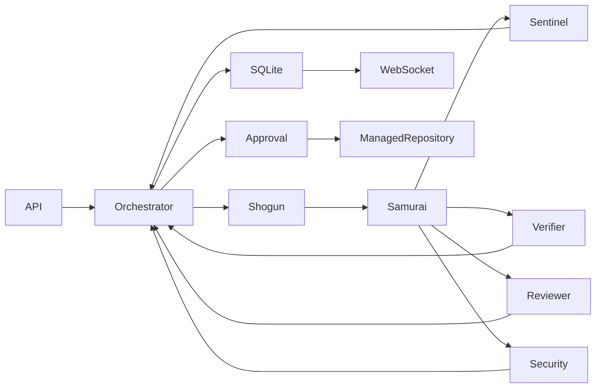

# DevPilot backend

DevPilot is a Bun/TypeScript service for registered, managed local repositories. Shogun plans, Samurai edits, Sentinel runs project checks, Verifier runs acceptance tests, and Reviewer and Security examine the candidate in parallel. SQLite stores the shared event log and mission projection. The baseline check runs before planning, and its event ID is included in the plan. Failed checks and findings go back to the editor. A candidate with no diff escalates with `NO_CHANGES`. A human must approve the checked revision before the mission’s own managed target changes. Each new fixture mission starts from a fresh copy of the registered seed.

## Run and test

Install Bun, Python 3, and pytest (`python3 -m pip install --user pytest`; on externally managed Python installations add `--break-system-packages` when appropriate). Run `bun install` to install dependencies, then `bun test`. The integration tests use the fixture directory and explicitly enable the unisolated development runner.

`config/repositories.json` refers to the fixture manifest at `fixtures/registry.json` relative to `DEVPILOT_FIXTURES_DIR` (default `../devpilot-fixtures`). That manifest registers the exact requests, check arguments, private suite locations, and pinned suite digests. The registry and suites remain outside agent snapshots. Override the config path with `DEVPILOT_REGISTRY`, and the runtime directory with `DEVPILOT_RUNTIME`.

For isolated operation, install Docker or Podman and make an offline image containing Python and pytest available locally. Set `DEVPILOT_CONTAINER_IMAGE` to its immutable `name@sha256:<digest>` reference. Start with `bun run start`; the API listens on 127.0.0.1:8787. The service refuses to start without a container runtime and pinned image. Set `MINIMAX_API_KEY` or `MINIMAX_TOKEN_PLAN_KEY` in the environment for MiniMax-M3.1-Flash. Set `DEVPILOT_MODEL=mock` for the deterministic fixture scripts. MiniMax reasoning effort defaults to `low` to fit the mission deadline; set `DEVPILOT_REASONING_EFFORT` to `low`, `medium`, `high`, `xhigh`, or `max` to change it.

For trusted local development only, `DEVPILOT_ALLOW_UNISOLATED=1` explicitly permits host subprocess execution without Docker or Podman. **This provides no security boundary against repository code**: it can access host files, processes, and network under the service account. Each resulting `test_result` includes `payload.isolation: "unisolated"`. Such missions escalate with `ISOLATION_UNAVAILABLE` and cannot enter the approval gate. The server passes a restricted environment to subprocesses, but the flag is unsuitable for untrusted code.

## API and execution

- `POST /missions` accepts `{"repo":"stock","request":"<exact registered request>","mode":"multi"}`. Use `"baseline"` for the single-agent baseline. The response includes `mission_id`.
- `GET /missions/:id` returns mission state, usage totals, pairing fields, and an event watermark.
- `GET /missions/:id/artifacts/:artifactId` returns a mission-scoped diff or redacted debug artifact as plain text.
- `ws://localhost:8787/ws?mission=<id>&after=<event-id>` replays and streams events.
- For a paired baseline, pass `"mode":"baseline"` and `"paired_mission_id":"<multi-agent-mission-id>"` with the same repo and request. The baseline starts from the multi-agent run's original base.
- `POST /missions/:id/approve` accepts `{"approved":true}` or false only at the approval gate. Apply changes `runtime/missions/<mission-id>/target/current`; the fixture seed and other missions are not modified. The candidate and base hashes are checked again before the atomic pointer swap. A repeated decision returns `409`.

Model turns have separate mission-wide and per-role caps. The initial mission cap is 44 turns (52 for feature requests), with 16 added per fix cycle up to 100 turns. `DEVPILOT_MISSION_TURN_LIMIT` sets the initial cap (1–200), `DEVPILOT_TURN_EXTENSION_PER_FIX` sets the increment (default 16, 0 disables it), and `DEVPILOT_MAX_MISSION_TURNS` sets the hard maximum (default 100, or the initial cap if higher; at least the initial cap and at most 200). Shogun has 6 turns, Samurai 16 (22 for features), the reviewer 8, security 12, and the baseline 28 (36 for features). Reviewer and verifier role caps apply per candidate revision; other role caps apply across the mission. The mission cap and usage totals always span all revisions. Usage events report the effective mission cap, role budgets, and per-role turns for the current revision. Each attempt, including continuations and repairs, counts against both applicable caps. On the last available turn, only the phase's submit tool is exposed and the agent is instructed to submit its result. Reviewers receive the diff and changed paths; repeated reads of an unchanged file by the same reviewer return a short note, while each reviewer can independently read it once per revision. Turn-limit escalations link to a redacted debug artifact with the latest replies.

Missions start with a 150-second deadline. Each send-back/fix cycle adds 60 seconds, up to a 300-second total from mission creation. Set `DEVPILOT_FIX_EXTENSION_SECONDS` (default `60`, including `0` to disable) and `DEVPILOT_MAX_MISSION_SECONDS` (default `300`, at least `150`) to integer seconds. No more than three fix cycles are allowed. The current deadline is reported when a mission starts and when a task is sent back.

Reviewer findings block only when marked in scope and supported by an existing file and line or a concrete failing case. Unsupported, out-of-scope, addressed, and repeated send-back findings become non-blocking advisories; generic scanner patterns are advisory too. The service checks the evidence format and file/line existence, but does not independently prove the model's scope claim or failing case. Public and private tests still gate approval.

Review prompts treat the configured storage root and its ancestors as trusted unless the request explicitly includes an attacker replacing them. Symlink escapes through paths inside the root remain in scope when the request forbids them. This is a review-scoping assumption, not protection against an attacker who controls the configured root or its parent.

Browser origins are allowed when same-origin or explicitly listed in `DEVPILOT_ALLOWED_ORIGINS` as comma-separated exact origins. The default list is `http://localhost:5173,http://127.0.0.1:5173`. Allowed cross-origin requests receive CORS headers; other origins are rejected.

Samurai can use `read_file`, `list_dir`, `search`, `edit_file`, and `run_cmd`; `run_cmd` accepts only the registered check ID. The editor is shown that ID in its prompt and tool schema. Other model roles cannot edit. Tests and test configuration (including `tests/`, `test_*.py`, `*_test.py`, `conftest.py`, `pytest.ini`, `pyproject.toml`, `setup.cfg`, and CI/test tooling) are protected from edits. README and documentation changes are allowed and emit a non-blocking finding. Edits use staged, path-confined copies; symlinks and special files are rejected. In isolated mode, project tests run with networking disabled, bounded resources, and a read-only candidate mount. For acceptance, the service copies the candidate and suite into separate read-only directories. A fresh pytest interpreter runs a trusted collection pass and then the suite with an explicit configuration, `--confcutdir`, plugin autoload disabled, and no candidate files on its import path. Candidate functions and objects are called through a restricted RPC proxy in a separate fresh worker interpreter. In isolated mode, pytest and the candidate worker use separate offline containers; the worker does not receive the private suite, JUnit report, or bridge directory. Both processes receive a shared scratch directory only for test inputs and outputs. JUnit is written outside the candidate tree and checked against the test IDs collected without candidate execution. Missing or malformed reports, missing or extra IDs, unexpected exits, and timeouts fail closed. Events contain only test IDs and pass/fail summaries, never private source or tracebacks.

The RPC bridge supports top-level Python modules, callable functions and classes, object methods, and common JSON-like values, tuples, iterators, and paths. Suites that require direct access to a candidate's Python objects or unsupported types need a purpose-built harness; an unsupported interaction fails rather than passing. Hidden inputs are visible to candidate code as calls are made. The unisolated flag is best effort only: the verifier attempts a separate network namespace when the host permits it, but otherwise network access remains possible. The subprocesses still share the service account and host filesystem, so hostile code can chmod files and access other same-user files or processes. Use the rootless container mode for an actual boundary. The rootless container path depends on the configured Docker or Podman runtime and image; the standard test suite also uses an unisolated test runner.

Agent messages and review conclusions are claims; observed test exits and scanner observations are labeled separately. The scanner detects a limited set of risky patterns and is not a comprehensive security audit. Incomplete missions escalate on restart, with recovery of a completed pointer swap. This implementation assumes one service instance and a trusted local service account; it does not provide multi-user authentication or host-level protection against a privileged administrator. Mock scripts are trusted configuration for controlled scenarios.

The full event envelopes, payload fields, usage accounting, replay behavior, and pairing contract are documented in [docs/EVENTS.md](docs/EVENTS.md).

For a single live Shogun plan check against the stock fixture, set `MINIMAX_API_KEY` and run `bun scripts/live-plan-check.ts`. It makes one model call and prints only whether the plan parsed and its task IDs. Malformed agent replies get one schema-specific repair attempt; rejected replies are redacted and stored in local runtime debug files referenced by artifact ID. Planning can finish through `submit_plan`; text replies are validated as a fallback. The adapter preserves complete assistant messages for tool continuations, as described in the [MiniMax tool-use guide](https://platform.minimax.io/docs/guides/text-m3-function-call).
