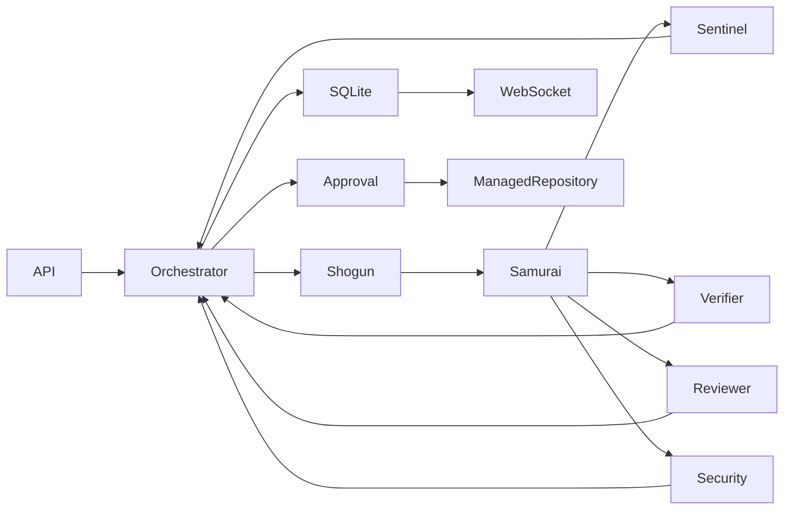

# DevPilot backend

DevPilot is a Bun/TypeScript service for registered, managed local repositories. Shogun plans, Samurai edits, Sentinel runs project checks, Verifier runs acceptance tests, and Reviewer and Security examine the candidate in parallel. SQLite stores the shared event log and mission projection. Failed checks and findings go back to the editor. A human must approve the checked revision before the managed repository pointer changes.

## Run and test

Install Bun, Python 3, and pytest (`python3 -m pip install --user pytest`; on externally managed Python installations add `--break-system-packages` when appropriate). Run `bun test`. The integration tests use the fixture directory and explicitly enable the unisolated development runner.

`config/repositories.json` refers to the fixture manifest at `fixtures/registry.json` relative to `DEVPILOT_FIXTURES_DIR` (default `../devpilot-fixtures`). That manifest registers the exact requests, check arguments, private suite locations, and pinned suite digests. The registry and suites remain outside agent snapshots. Override the config path with `DEVPILOT_REGISTRY`, and the runtime directory with `DEVPILOT_RUNTIME`.

For isolated operation, install Docker or Podman and make an offline image containing Python and pytest available locally. Set `DEVPILOT_CONTAINER_IMAGE` to its immutable `name@sha256:<digest>` reference. Start with `bun run start`; the API listens on 127.0.0.1:8787. The service refuses to start without a container runtime and pinned image. Set `MINIMAX_API_KEY` or `MINIMAX_TOKEN_PLAN_KEY` in the environment for MiniMax-M3.1-Flash. Set `DEVPILOT_MODEL=mock` for the deterministic fixture scripts.

For trusted local development only, `DEVPILOT_ALLOW_UNISOLATED=1` explicitly permits host subprocess execution without Docker or Podman. **This provides no security boundary against repository code**: it can access host files, processes, and network under the service account. Each resulting `test_result` includes `payload.isolation: "unisolated"`; the usage event retains its exact cumulative payload shape. The server passes a restricted environment to subprocesses, but the flag is unsuitable for untrusted code.

## API and execution

- `POST /missions` accepts `{"repo":"stock","request":"<exact registered request>","mode":"multi"}`. Use `"baseline"` for the single-agent baseline. The response includes `mission_id`.
- `GET /missions/:id` returns mission state, usage totals, pairing fields, and an event watermark.
- `GET /missions/:id/artifacts/:artifactId` returns a mission-scoped diff artifact as plain text.
- `ws://localhost:8787/ws?mission=<id>&after=<event-id>` replays and streams events.
- For a paired baseline, pass `"mode":"baseline"` and `"paired_mission_id":"<multi-agent-mission-id>"` with the same repo and request. The baseline starts from the multi-agent run's original base.
- `POST /missions/:id/approve` accepts `{"approved":true}` or false only at the approval gate. Apply changes `runtime/repos/<id>/current`; the imported source directory is not modified. The candidate and base hashes are checked again before the atomic pointer swap.

Samurai can use `read_file`, `list_dir`, `search`, `edit_file`, and `run_cmd`; `run_cmd` accepts only the registered check ID. Other model roles cannot edit. Edits use staged, path-confined copies; symlinks and special files are rejected. In isolated mode, project tests run with networking disabled, bounded resources, and a read-only candidate mount. For acceptance, the service copies the candidate and suite into separate read-only directories. A fresh pytest interpreter runs a trusted collection pass and then the suite with an explicit configuration, `--confcutdir`, plugin autoload disabled, and no candidate files on its import path. Candidate functions and objects are called through a restricted RPC proxy in a separate fresh worker interpreter. In isolated mode, pytest and the candidate worker use separate offline containers; the worker does not receive the private suite, JUnit report, or bridge directory. Both processes receive a shared scratch directory only for test inputs and outputs. JUnit is written outside the candidate tree and checked against the test IDs collected without candidate execution. Missing or malformed reports, missing or extra IDs, unexpected exits, and timeouts fail closed. Events contain only test IDs and pass/fail summaries, never private source or tracebacks.

The RPC bridge supports top-level Python modules, callable functions and classes, object methods, and common JSON-like values, tuples, iterators, and paths. Suites that require direct access to a candidate's Python objects or unsupported types need a purpose-built harness; an unsupported interaction fails rather than passing. Hidden inputs are visible to candidate code as calls are made. The unisolated flag is best effort only: the verifier attempts a separate network namespace when the host permits it, but otherwise network access remains possible. The subprocesses still share the service account and host filesystem, so hostile code can chmod files and access other same-user files or processes. Use the rootless container mode for an actual boundary. The rootless container path requires validation in an environment with Docker or Podman; it is not exercised by the unisolated tests on this machine.

Agent messages and review conclusions are claims; observed test exits and scanner observations are labeled separately. The scanner detects a limited set of risky patterns and is not a comprehensive security audit. Incomplete missions escalate on restart, with recovery of a completed pointer swap. This implementation assumes one service instance and a trusted local service account; it does not provide multi-user authentication or host-level protection against a privileged administrator. Mock scripts are trusted configuration for controlled scenarios.

The full event envelopes, payload fields, usage accounting, replay behavior, and pairing contract are documented in [docs/EVENTS.md](docs/EVENTS.md).
